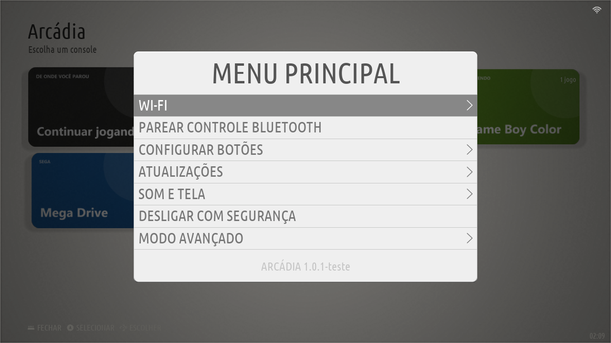

# Atualizações do Arcádia (Releases do GitHub)

Montado em 14/11/2026 (horário de Brasília). **Nenhuma versão foi publicada ainda** — tudo está pronto para a primeira, **Arcádia 1.0.0**.

## Como o aparelho procura atualização

```
aparelho (updatecheck.sh)
   │ 1. lê https://raw.githubusercontent.com/ricardofarney/console-retro-os/dev/atualizacao/versoes.txt
   │    → linha do canal configurado: "1.0.0;stable" ou "1.1.0;beta"
   │ 2. compara com /usr/config/EE_VERSION (versão instalada) — formato X.Y.Z
   │ 3. se for mais nova, baixa
   │    https://github.com/ricardofarney/console-retro-os/releases/download/v<versão>/Arcadia-Amlogic-ng.aarch64-<versão>.tar
   │    e confere com o .sha256 ao lado
   ▼
próximo boot: o initramfs aplica o .tar (KERNEL + SYSTEM); /storage não é tocado
```

| Peça | Arquivo |
|---|---|
| Endereços e comparação de versão | [packages/sx05re/emuelec/bin/updatecheck.sh](../packages/sx05re/emuelec/bin/updatecheck.sh) |
| Download e conferência | [packages/sx05re/emuelec/bin/batocera/emuelec-upgrade](../packages/sx05re/emuelec/bin/batocera/emuelec-upgrade) (faz backup antes com `arcadia-dados.sh backup`) |
| Versão da imagem | [packages/sx05re/emuelec/config/EE_VERSION](../packages/sx05re/emuelec/config/EE_VERSION) = `1.0.0` |
| Versões publicadas (lido pelos aparelhos) | [atualizacao/versoes.txt](../atualizacao/versoes.txt) — vazio até a primeira publicação |
| Canal do aparelho | `updates.type=stable` (ou `beta`) no `emuelec.conf`; `updates.enabled=1` verifica no boot |
| Nome dos arquivos | o build gera `Arcadia-Amlogic-ng.aarch64-<versão>-Generic.img.gz` (TV boxes, como o X2 Pro) e o `.tar` de atualização (`CUSTOM_IMAGE_NAME` no [compilar.sh](../ferramentas/wsl/compilar.sh)) |

O que mudou em relação ao EmuELEC:

- servidor: Releases do fork em vez de `EmuELEC/EmuELEC` e `EmuELEC-tests` (beta e estável no mesmo repositório; beta = pré-lançamento);
- comparação de versão reescrita para X.Y.Z (`sort -V`): a do EmuELEC só funcionava com versões de dois dígitos, como 4.8;
- mensagens em português;
- a "atualização forçada" não apaga mais as configurações (ver [CONFIGURACAO-DE-FABRICA.md](CONFIGURACAO-DE-FABRICA.md)).

## Como publicar uma versão

1. Ajuste a versão em `packages/sx05re/emuelec/config/EE_VERSION` (ex.: `1.0.1`), faça commit.
2. Compile: `ferramentas\wsl\compilar.ps1` (ver [AMBIENTE-BUILD.md](AMBIENTE-BUILD.md)). Saem `Arcadia-Amlogic-ng.aarch64-<versão>-Generic.img.gz` e `.tar` em `imagens-compiladas\` (só a imagem Generic, desde 15/11/2026).
3. Teste a imagem no aparelho.
4. Simule (não envia nada):

   ```powershell
   powershell -ExecutionPolicy Bypass -File "D:\Adube Sistemas\Console de Jogo\console-retro-os\ferramentas\publicar-versao.ps1" -Versao 1.0.1
   ```

   Prepara `imagens-compiladas\publicar\v1.0.1\` com os dois arquivos, um `.sha256` para cada e `NOTAS.md` (notas em português geradas a partir dos commits desde a última versão).
5. Publique:

   ```powershell
   powershell -ExecutionPolicy Bypass -File "D:\Adube Sistemas\Console de Jogo\console-retro-os\ferramentas\publicar-versao.ps1" -Versao 1.0.1 -Publicar
   ```

   Cria a Release `v1.0.1` em <https://github.com/ricardofarney/console-retro-os/releases> e grava `1.0.1;stable` em `atualizacao/versoes.txt` (commit + push). A partir daí os aparelhos no canal estável encontram a atualização.

Opções: `-Canal beta` (pré-lançamento, só para aparelhos com `updates.type=beta`), `-Notas arquivo.md` (notas próprias), `-Rascunho` (ver "Ensaio" abaixo).

Proteções do script: recusa versão fora do formato X.Y.Z ou diferente do `EE_VERSION`; recusa arquivo acima de 2 GB (limite do GitHub); recusa Release já existente ou repositório com alterações não commitadas. Versão com sufixo (ex.: `1.0.1-teste`) só é aceita como rascunho.

## Ensaio sem afetar ninguém (rascunho + simulação)

1. Compile a versão de teste numa branch local (o `dev` continua na versão de verdade):

   ```powershell
   git checkout -b teste-1.0.1     # EE_VERSION = 1.0.1-teste, commit
   git checkout dev
   Start-Process powershell -WindowStyle Hidden -ArgumentList '-NoProfile','-ExecutionPolicy','Bypass','-File','"D:\Adube Sistemas\Console de Jogo\console-retro-os\ferramentas\wsl\compilar.ps1"','-Branch','teste-1.0.1'
   ```

2. Publique como **rascunho**: a Release fica invisível ao público e aos aparelhos, e o `versoes.txt` não muda.

   ```powershell
   powershell -ExecutionPolicy Bypass -File "D:\Adube Sistemas\Console de Jogo\console-retro-os\ferramentas\publicar-versao.ps1" -Versao 1.0.1-teste -Rascunho -Publicar
   ```

3. Simule o aparelho no Ubuntu do WSL. O [simular-atualizacao.sh](../ferramentas/simular-atualizacao.sh) roda os scripts **reais** da imagem (`emuelec-upgrade`, `updatecheck.sh`, `arcadia-dados.sh`) num "aparelho de mentira":
   - troca só os caminhos absolutos e os endereços do GitHub por um servidor local;
   - o servidor local serve os mesmos arquivos do rascunho.

   ```bash
   bash simular-atualizacao.sh 1.0.0 1.0.1-teste
   ```

4. Apague o rascunho: `gh release delete v1.0.1-teste --repo ricardofarney/console-retro-os --yes` (sem `--cleanup-tag`: rascunho não cria tag). Depois do ensaio de 15/11/2026, com OK do usuário, foram apagados o rascunho, a branch local `teste-1.0.1`, as imagens 1.0.1-teste e a pasta `publicar1.0.1-teste`.

**Nunca instale uma versão de teste no aparelho de verdade.** Para o `sort -V`, `1.0.1-teste` vem **depois** de `1.0.1`. Um aparelho com a versão de teste só receberia a partir da `1.0.2`. Se acontecer, regrave o cartão ou copie o `.tar` certo para `\\ARCADIA\Update`.

### Resultado do ensaio de 15/11/2026 (1.0.0 → 1.0.1-teste)

**Mudança visível da versão de teste:** o rodapé do MENU PRINCIPAL passou a mostrar "ARCÁDIA <versão>" (antes "EMUELEC ES V42 IP:", que era a versão do EmulationStation). Essa mudança fica também na 1.0.0.



**Build e verificação:**
- Build da branch `teste-1.0.1` em 4 minutos (incremental, já gerando só a Generic).
- `verificar-imagem.sh` na imagem 1.0.1-teste: **14 OK, 0 falha**.

**Rascunho no GitHub:**
- Release "Arcádia 1.0.1-teste" criada com `isDraft: true`.
- Os SHA-256 calculados pelo GitHub para os arquivos enviados são iguais aos locais: `.tar` `0f983d2b…`, `.img.gz` `5a523fac…`.
- `versoes.txt` não mudou.

**Simulação no WSL:** 11 OK, 0 falha (relatório em `imagens-compiladas\logs\simulacao-atualizacao-2026-11-15_0226.md`).

| Item | Resultado |
|---|---|
| Detecta a versão nova | `emuelec-upgrade canupdate` → `1.0.1-teste` |
| Tamanho do download | 1.487.687.680 bytes (1418 MB) |
| Baixa e confere o SHA-256 | "valid checksum."; arquivo baixado idêntico ao publicado |
| Percentual do download na tela | 0% → 20% → 42% → 64% → 88% (depois da correção abaixo) |
| Cópia de segurança antes de atualizar | `antes-da-atualizacao-<data>.tar.gz` com `es_settings`, `emuelec.conf`, coleções e `retroarch.cfg` |
| Arquivo corrompido | recusado ("invalid checksum", código 1) |
| Já atualizado / versão mais velha | não oferece ("no") |
| **Nada apagado** | os 9 arquivos do usuário (gamelist com favorito, `FavoriteSystems=nes,megadrive`, `.srm`, `.state.auto` + miniatura, `emuelec.conf`, coleção própria, `retroarch.cfg`) têm o mesmo SHA-256 antes e depois |

**Defeitos encontrados e corrigidos:**
- **`publicar-versao.ps1` não conseguia publicar.** No PowerShell 5.1, com `$ErrorActionPreference='Stop'`, o aviso "release not found" que o `gh` escreve na saída de erro (justamente o caso normal, de Release ainda inexistente) virava erro fatal. Corrigido: na parte de publicação, vale só o código de saída.
- **Percentual do download parava a partir de 1 GB** (`emuelec-upgrade`, herdado do EmuELEC): o `sed` que lia o tamanho no `stat` esperava um espaço depois do número, e a partir de 10 dígitos vem direto uma tabulação. Agora usa `stat -c %s` (funciona também no busybox do aparelho).

**O que acontece no reboot (lido no código, não executado):** o `init` do initramfs troca só `KERNEL` e `SYSTEM` na partição de boot e roda o `update.sh` do bootloader. Esse script regrava o `dtb.img` com o DTB do próprio aparelho, identificado pelo device tree em uso. Depois limpa `/storage/.update`. Nada em `/storage` é apagado. **CONFIRMAR no aparelho**, na primeira atualização de verdade, que o `dtb.img` continua o certo.

## Voltar para uma versão anterior

- Num aparelho: grave o `.img.gz` da versão anterior (o cartão é apagado; antes, copie a pasta de roms/saves) **ou** copie o `.tar` da versão anterior para `\\ARCADIA\Update` e reinicie.
- Para todos: edite `atualizacao/versoes.txt` voltando a linha do canal (aparelhos já atualizados não "voltam" sozinhos — só oferecem versões mais novas).

## Testado

| Teste | Resultado |
|---|---|
| `bash -n updatecheck.sh` (sintaxe) | ok |
| comparação X.Y.Z (1.0.1>1.0.0, 1.0.10>1.0.9, 2.0.0>1.9.9; 1.0.0=1.0.0 não atualiza) | ok |
| `publicar-versao.ps1` em simulação com arquivos fictícios (cópia, `.sha256` no formato do aparelho, notas com acentos) | ok |
| recusa de versão diferente do `EE_VERSION` | ok |
| detecção, download, SHA-256, recusa de arquivo corrompido e preservação dos dados com os scripts reais (simulação no WSL, 15/11/2026) | ok (ver "Ensaio") |
| publicação como rascunho no GitHub (15/11/2026) | ok |
| download real no aparelho e aplicação no reboot | **só no aparelho**, depois da primeira publicação |
