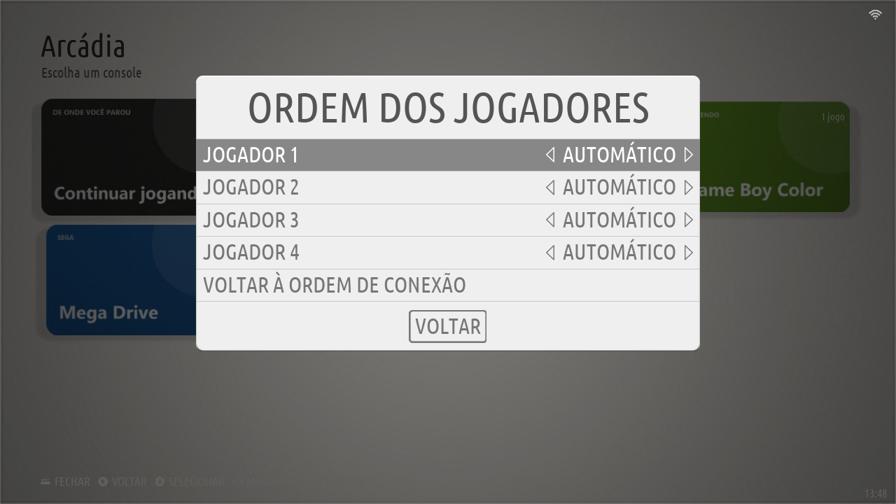

# Funções novas do Arcádia (EmulationStation)

Fork: <https://github.com/ricardofarney/arcadia-emulationstation> — branch **`arcadia`**, criada a partir do commit `3de652c6` (o mesmo que o EmuELEC usava). Cópia local: `D:\Adube Sistemas\Console de Jogo\arcadia-emulationstation`.

O build da imagem usa o fork: [packages/sx05re/emuelec-emulationstation/package.mk](../packages/sx05re/emuelec-emulationstation/package.mk) (`PKG_SITE` = fork, `PKG_GIT_CLONE_BRANCH="arcadia"`, `PKG_VERSION` = commit). Ao mudar o fork: commit + push na branch `arcadia` e atualizar `PKG_VERSION` com o novo commit.

Implementado em 14/11/2026 (horário de Brasília), commit `0c64beb` do fork.

## 1. Favoritar consoles (botão Y na tela inicial)

| Item | Como funciona |
|---|---|
| Marcar/desmarcar | **toque curto no Y** na tela inicial; aparece o aviso "★ <console> ADICIONADO AOS CONSOLES FAVORITOS" (ou REMOVIDO) |
| Busca | continua disponível **segurando o Y** |
| Onde fica salvo | `FavoriteSystems` (lista separada por vírgula) no `es_settings.cfg` da área do usuário (`/storage/.config/emulationstation/`) — **sobrevive a atualizações** e entra no backup do `arcadia-dados.sh` |
| Ordem da tela inicial | consoles favoritos → "Continuar jogando" → "Favoritos" (jogos) → demais consoles e coleções |
| No tema | propriedade nova `{system:favorite}` mostra a ★ no card do console |
| Desligar a função | `ArcadiaFavoriteSystems=false` no `es_settings.cfg` (Y volta a ser só a busca) |

Arquivos: `es-app/src/SystemData.{h,cpp}` (`isFavoriteSystem`, `toggleFavoriteSystem`, `applyArcadiaSystemOrder`, propriedade `favorite`), `es-app/src/CollectionSystemManager.cpp` (aplica a ordem ao montar a lista), `es-app/src/views/SystemView.{h,cpp}` (botão Y e rodapé "FAVORITAR CONSOLE"), `es-core/src/Settings.cpp` (padrões).

Limite: a grade usa cards do mesmo tamanho; os favoritos ficam **primeiro e com ★**, mas não maiores (o EmulationStation não permite tamanhos diferentes na mesma grade).

## 2. "Continuar de onde parei / Começar do início"

O EmulationStation do EmuELEC **já tinha** a janela de escolha de save (`GuiSaveState`), ativada por `ShowSaveStates` — agora ligada de fábrica no `es_settings.cfg` da imagem. No fork:

- o **save automático vem primeiro**, com o texto **"CONTINUAR DE ONDE PAREI"**, data/hora e miniatura da tela;
- o item de novo jogo virou **"COMEÇAR DO INÍCIO"**;
- título da janela em pt-BR: "ONDE VOCÊ QUER COMEÇAR?"; slots manuais continuam listados depois.

Arquivo: `es-app/src/guis/GuiSaveState.cpp`.

## 3. Configurações simplificadas

Menu principal (Start) com **6 itens** + modo avançado:

| Item | Abre |
|---|---|
| Wi-Fi | configurações de rede do EmuELEC |
| Parear controle Bluetooth | pareamento automático (`ThreadedBluetooth`) |
| Configurar botões | submenu: **Mapear um controle** (configuração de controle de antes) e **Ordem dos jogadores** (jogadores 1 a 4, ver abaixo) |
| Atualizações | atualizações e downloads (servidor do Arcádia — [ATUALIZACOES.md](ATUALIZACOES.md)) |
| Som e tela | submenu com "Ajustes de áudio" e "Tela" (resolução e opções de vídeo do EmuELEC) |
| Desligar com segurança | confirmação "DESLIGAR O CONSOLE?" e desligamento normal |
| **Modo avançado** | o menu completo original do EmuELEC |

Desligar: `ArcadiaMenuSimples=false` no `es_settings.cfg` volta ao menu completo direto. Em modo Kiosk/Criança o menu simplificado não é usado (mantém o comportamento do EmuELEC).

Arquivos: `es-app/src/guis/GuiMenu.{h,cpp}` (`addArcadiaEntries`, `openArcadiaSomTela`, `openArcadiaBotoes`, parâmetro `arcadiaCompleto`).

## 4. Ordem dos jogadores (até 4 jogadores)

Commit `50df2c3` (16/11/2026), decisão "até 4 jogadores" ([MULTIJOGADOR.md](MULTIJOGADOR.md)):

- **Configurar botões → Ordem dos jogadores**: a tela de atribuição de controles do EmuELEC, só com os jogadores 1 a 4 (`GuiControllersSettings` com o parâmetro `arcadiaOrdem`, aberta por `openArcadiaPlayerOrder`). Cada "JOGADOR n" escolhe um controle conectado ou **AUTOMÁTICO**. **VOLTAR À ORDEM DE CONEXÃO** apaga as escolhas (`INPUT Pn*` = `DEFAULT`).
- **Ordem de conexão**: os controles sem jogador escolhido são ordenados pelo número de instância do SDL (cresce a cada controle conectado), em vez do caminho do dispositivo (`InputManager::computePlayersConfigs`). Opção `ArcadiaOrdemConexao` (padrão `true`); com `false` volta a ordem do EmuELEC.
- O menu completo (Modo avançado → Controles) continua igual, com 8 jogadores.

## Traduções

13 textos novos em `locale/lang/pt_BR/LC_MESSAGES/emulationstation2.po` (validado com `msgfmt --check`): WI-FI, PAREAR CONTROLE BLUETOOTH, CONFIGURAR BOTÕES, ATUALIZAÇÕES, SOM E TELA, TELA, DESLIGAR COM SEGURANÇA, MODO AVANÇADO, FAVORITAR CONSOLE, avisos de favorito, CONTINUAR DE ONDE PAREI, COMEÇAR DO INÍCIO. Em 16/11/2026, mais 6: MAPEAR UM CONTROLE, ORDEM DOS JOGADORES, QUAL CONTROLE CADA JOGADOR USA, JOGADOR %i, AUTOMÁTICO, VOLTAR À ORDEM DE CONEXÃO.

Regra aprendida: **nada de acento em comentários do código C++** — o `xgettext` do build falha com "Non-ASCII comment". Textos com acento só no `.po`.

## Compilação

- **Teste rápido (x86_64, Ubuntu do WSL):** `ferramentas-arcadia/compilar-teste-wsl.sh` no fork — compilou sem erros em 14/11/2026 (`COMPILACAO-OK`), com `-DENABLE_EMUELEC=1`.
- **Imagem do aparelho (aarch64):** compilou no build completo de 14/11/2026 (binário `ELF 64-bit ARM aarch64`, `.mo` pt-BR com os textos novos) e está na imagem `Arcadia-Amlogic-ng.aarch64-1.0.0` — ver [AMBIENTE-BUILD.md](AMBIENTE-BUILD.md#resultado-do-build-final-14112026-2217).

## O que só pode ser testado no aparelho

| Item | Por quê |
|---|---|
| Y favoritando console, ordem da tela inicial e ★ no card | o RetroBat usa o EmulationStation dele, sem estas mudanças |
| Janela "Continuar de onde parei" com miniatura | depende do save automático do RetroArch do EmuELEC |
| Menu simplificado: Wi-Fi, Bluetooth, botões, atualizações, som/tela, desligar | funções do sistema EmuELEC (scripts `batocera-*`, `emuelec-*`) |
| Recursos do tema no ES do EmuELEC (grade, `itemTemplate`, `{system:total}`) | testados no ES do RetroBat, que é mais novo |
