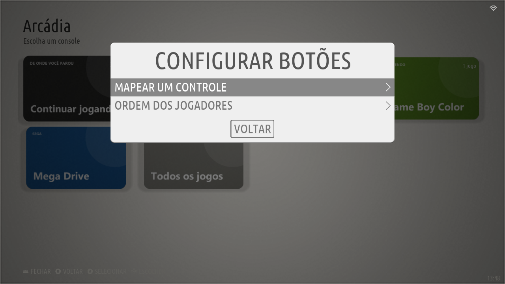
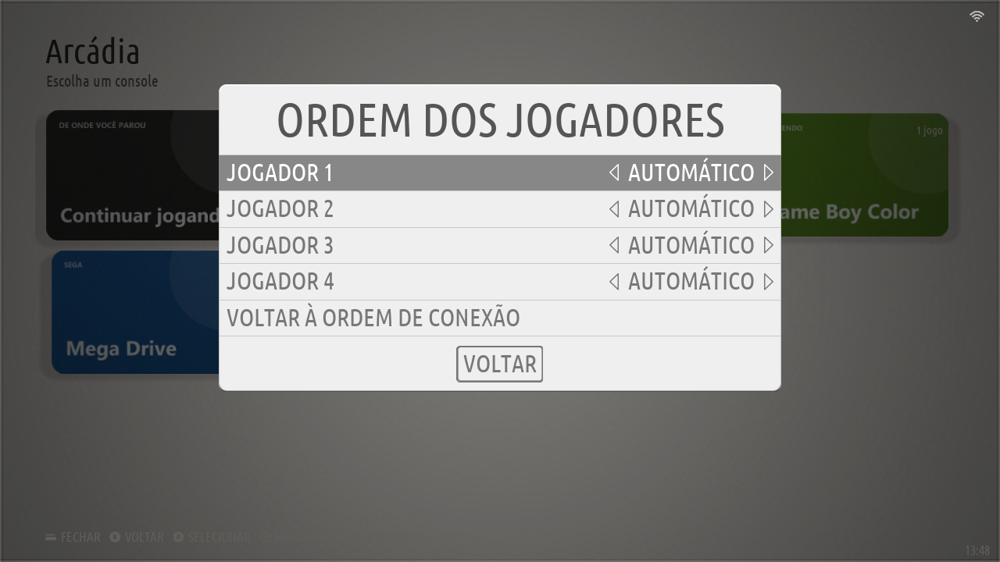

# Multijogador: até 4 jogadores

**Decisão do usuário (16/11/2026, horário de Brasília):** o Arcádia suporta **até 4 jogadores**. O padrão é **2**; 3 ou 4 jogadores só quando o jogo permitir. Registrada também em [PROJETO.md](PROJETO.md) e [DESIGN.md](DESIGN.md).

Resumo do que foi feito:

| Parte | Onde |
|---|---|
| Até 4 controles ao mesmo tempo, na ordem de conexão | EmulationStation do fork + configuração da imagem (seção 1) |
| "Configurar botões → Ordem dos jogadores" (jogadores 1 a 4) | fork `arcadia-emulationstation`, commit `50df2c3` |
| Multitap automático só nos jogos de 3 ou mais jogadores | `ferramentas/multijogador/` + pacote `arcadia-multijogador` + `emuelecRunEmu.sh` |
| Campo "jogadores" na ficha do jogo | `ferramentas/roms/limpar-roms.py` 1.2 |
| Conferência na imagem | item 11 do [verificar-imagem.sh](VERIFICACAO-IMAGEM.md) |

## 1. Controles: até 4 ao mesmo tempo

| Camada | Situação na imagem |
|---|---|
| Kernel (Amlogic-ng) | `joydev`, `xpad` (controles Xbox/compatíveis), `hid-generic`, `usbhid`, `uhid` e `hidp` (Bluetooth), `hid-sony`, `hid-playstation`, `hid-microsoft`, `hid-logitech`, `hid-dragonrise`, `hid-greenasia`, `hid-smartjoyplus`, `hid-steam`. Hub USB é do núcleo USB. |
| EmulationStation | trata até 8 jogadores (`MAX_PLAYERS 8`) e passa ao lançador `-p<n>index` e `-p<n>guid` de cada um |
| `setsettings.sh` | grava `input_player1..5_joypad_index` do RetroArch a partir da ordem do ES |
| RetroArch | `input_max_users = 5` (4 jogadores + o 5º do Super Multitap, que fica disponível mas não é o objetivo) |

Os **2 controles sem fio da caixa** (receptor 2,4 GHz no USB), os **controles USB pelo hub** e os **controles Bluetooth** entram todos como joysticks comuns. Não há limite próprio do Arcádia abaixo de 4.

### Ordem dos jogadores = ordem de conexão

No EmuELEC original, os controles sem jogador escolhido eram ordenados pelo **caminho do dispositivo** no sistema (comparado como texto), que não acompanha a ordem em que os controles foram ligados. No Arcádia (opção `ArcadiaOrdemConexao`, ligada de fábrica) eles seguem a **ordem de conexão**, isto é, o número de instância que o SDL dá a cada controle, sempre crescente:

- controle ligado primeiro = jogador 1, o segundo = jogador 2, e assim por diante;
- quem desliga e liga de novo vai para o fim da fila;
- controles que já estavam ligados quando o sistema iniciou ficam na ordem em que o sistema os encontrou.

Para fixar um controle num jogador, use **Configurar botões → Ordem dos jogadores**.

### Configurar botões → Ordem dos jogadores

No menu simplificado, **Configurar botões** virou um submenu:

| Item | O que faz |
|---|---|
| Mapear um controle | o mapeamento de botões de antes (pergunta "tem certeza?" e abre a detecção) |
| **Ordem dos jogadores** | a tela de atribuição P1–P4 do EmuELEC, só com os jogadores 1 a 4 e traduzida: cada "JOGADOR n" escolhe um controle conectado ou **AUTOMÁTICO** (ordem de conexão). **VOLTAR À ORDEM DE CONEXÃO** limpa todas as escolhas. |





As escolhas ficam em `es_settings.cfg` (`INPUT P1NAME/GUID/PATH`…), as mesmas chaves do menu completo do EmuELEC (Modo avançado → Controles), que continua com os 8 jogadores.

## 2. Multitap automático por jogo

Super Nintendo, Mega Drive e PlayStation só têm 2 entradas de controle. Os jogos de 3 ou 4 jogadores usavam um **adaptador** (multitap). Ligar o adaptador em todos os jogos atrapalharia os de 1 ou 2 jogadores; por isso o Arcádia liga **só nos jogos da lista**, com um override do RetroArch para aquele jogo.

### Como funciona no aparelho

```
ES abre o jogo → emuelecRunEmu.sh → setsettings.sh (configuração geral)
                                  → arcadia-multijogador.sh <sistema> <jogo> <núcleo>
                                       │ normaliza o nome do arquivo (ex.: "Super Bomberman 2 (USA).sfc" → superbomberman2)
                                       │ procura em /usr/share/arcadia/multijogador/<console>.txt
                                       ├─ está na lista → grava o override só desse jogo
                                       └─ não está     → não faz nada (1 ou 2 jogadores, como sempre)
                 → RetroArch abre e carrega o override do jogo por cima da configuração geral
```

| Console | Núcleo | O que o override liga | Arquivo |
|---|---|---|---|
| Super Nintendo | snes9x (padrão), snes9x2010 | `input_libretro_device_p2 = "257"`: Super Multitap na porta 2 (jogadores 2 a 5) | `config/Snes9x/<jogo>.cfg` |
| Mega Drive | Genesis Plus GX (padrão; também Wide e cart_special) | Team Player: `input_libretro_device_p1 = "1537"` (jogadores 1 a 4 na porta 1). 4 Way Play (jogos da EA): `p1` e `p2 = "1025"` | `config/Genesis Plus GX/<jogo>.cfg` |
| Mega Drive | PicoDrive | `picodrive_input1 = "team player"` ou `"4way play"` | `config/PicoDrive/<jogo>.opt` |
| PlayStation | PCSX ReARMed (padrão `pcsx_rearmed_32b`) | `pcsx_rearmed_multitap = "port 1"`: multitap na porta 1 (jogadores 1 a 4) | `config/PCSX-ReARMed/<jogo>.opt` |
| Nintendo 64 | mupen64plus_next (padrão) | nada: o console tem 4 entradas de controle | — |
| Arcade | mame2003_plus (padrão), FBNeo | nada: cada jogador é uma entrada do RetroArch (até `input_max_users`) | — |

`config/` = `/storage/.config/retroarch/config/`. Os códigos de tipo de controle foram conferidos no código-fonte dos núcleos da imagem: `RETRO_DEVICE_JOYPAD_MULTITAP = (1<<8)|1` no snes9x, e `RETRO_DEVICE_SUBCLASS(JOYPAD, 3)` / `(JOYPAD, 5)` no Genesis Plus GX. As opções de núcleo foram conferidas em `libretro_core_options.h` do PicoDrive e do PCSX ReARMed.

Cuidados do gerador:

- **`.opt` do jogo:** o RetroArch usa o `.opt` do jogo **no lugar** das opções do núcleo. Opção que faltar volta ao padrão do núcleo. Por isso o gerador cria o `.opt` como cópia das opções do núcleo daquele momento (as de desempenho do [DESEMPENHO-S905X2.md](DESEMPENHO-S905X2.md) inclusive) e só troca a do multitap. Depois de criado, ele só garante a linha do multitap: mudanças que a pessoa faça nas opções desse jogo são mantidas.
- **Override feito pela pessoa** (arquivo `.cfg` sem a marca do Arcádia): é mantido, e só o tipo de controle é acertado. Esse arquivo nunca é apagado pelo gerador.
- **Registro:** os arquivos criados pelo gerador ficam listados em `config/.arcadia-multijogador`. Se um jogo sair da lista numa atualização, o gerador retira o arquivo que ele mesmo criou na próxima vez que o jogo for aberto.
- **Nada fica preso:** o RetroArch descarrega o override antes de gravar a configuração ao sair (conferido em `retroarch.c`, `config_unload_override()` antes de `CMD_EVENT_MENU_SAVE_CURRENT_CONFIG`). Assim, o multitap de um jogo não passa para os outros.
- Log do último jogo aberto: `/emuelec/logs/arcadia-multijogador.log`.

### As listas

Ficam em [ferramentas/multijogador](../ferramentas/multijogador/LEIA-ME.md) (lista e gerador juntos, como pedido) e vão para a imagem pelo pacote `packages/sx05re/arcadia-multijogador`.

| Console | Títulos oficiais na lista | Fonte (lista conhecida da comunidade) |
|---|---|---|
| Super Nintendo | 79 | [Nintendo Wiki — Super Multitap](https://nintendo.fandom.com/wiki/Super_Multitap) (76 jogos, com o número de jogadores) |
| Mega Drive | 94 (Team Player ou 4 Way Play) | [Sega Retro — Team Player](https://segaretro.org/Team_Player) (60) e [4 Way Play](https://segaretro.org/4_Way_Play) (45) |
| PlayStation | 320 | [Wikipedia — PlayStation Multitap](https://en.wikipedia.org/wiki/PlayStation_Multitap) (327) |

- **Por que não só No-Intro/Redump:** as DATs No-Intro/Redump não têm o campo de jogadores. A base `metadat/maxusers` do libretro-database tem, mas mistura jogos simultâneos com jogos de turnos (golfe, pinball, Monopoly), deixa de fora jogos como NBA Jam e Gauntlet IV do Mega Drive, não diz qual adaptador cada jogo usa e não cobre o PlayStation. Ela é usada só para o campo "jogadores" (seção 3).
- **Montagem:** `montar-listas.py` cruza cada título da fonte com as DATs do repositório (`ferramentas/roms/dats`) e grava todos os nomes oficiais correspondentes (regiões e variações). `apelidos.txt` resolve os nomes diferentes (ex.: "Crash Team Racing" → "CTR - Crash Team Racing") e ignora o que não existe na DAT (homebrews de 2020+, jogos de outro aparelho). Na última montagem nenhum título ficou sem correspondência.
- **Jogos que aceitam os dois adaptadores** no Mega Drive (NBA Jam, Gauntlet IV, FIFA International Soccer, Mega Bomberman…) ficam com o Team Player.
- Fontes baixadas em 16/11/2026 13:23 (horário de Brasília). Revisões: Nintendo Wiki 1195819, Sega Retro 1168703 e 1163287, Wikipedia 1377234328.

## 3. Campo "jogadores" na ficha do jogo

O `limpar-roms.py` (versão 1.2) preenche `<players>` no `gamelist.xml` (ex.: `1-4`), que a ficha do jogo mostra em "Jogadores":

1. pelo **CRC** da ROM na base `metadat/maxusers` (guardada em `ferramentas/roms/dats/maxusers`, mesmo commit `b2e5eaa` das outras DATs, 22 arquivos, 1,9 MB);
2. pelo **nome oficial** (DAT) ou pelo nome do arquivo;
3. pelas **listas de multitap** (prevalecem quando dizem mais jogadores, e cobrem o PlayStation, que não tem `maxusers`).

Valor que já existe no `gamelist.xml` (vindo do scraper, por exemplo) **não é trocado**. Detalhes em [LIMPEZA-ROMS.md](LIMPEZA-ROMS.md).

## 4. Testado no PC (WSLg, 16/11/2026)

| Teste | Resultado |
|---|---|
| `ferramentas/multijogador/testar-gerador.sh`: gerador e listas do repositório, 18 casos (SNES com/sem multitap, nome com ", The", nome fora do padrão `(U) [!]`, núcleo sem suporte, Team Player, 4 Way Play, PicoDrive, PCSX com cópia das opções de desempenho, N64/Arcade sem arquivo, override próprio preservado, saída da lista) | **18 OK, 0 falha** (`imagens-compiladas\logs\teste-multijogador-2026-11-16_1328.md`) |
| `ferramentas/multijogador/testar-retroarch.sh provar`: RetroArch abrindo os jogos com os overrides gerados | **7 OK, 0 falha** (`imagens-compiladas\logs\teste-retroarch-multijogador-2026-11-16_1344.md`) |
| Tela "Configurar botões" e "Ordem dos jogadores" no ES do fork (fotos acima); "Voltar à ordem de conexão" grava `INPUT P1NAME=DEFAULT` | ok |
| `limpar-roms.py` numa pasta de teste: Super Bomberman 2 → `1-4`, Secret of Mana → `1-3`, Sonic → `1`, CTR (PS1) → `1-4`; `1-2` e o favorito que já existiam no Super Mario World foram mantidos; busca pelo CRC da `maxusers` conferida | ok |
| Verificação da imagem 1.0.0 recompilada (16/11/2026 13:57, commit `951a1c33`) | **15 OK, 0 falha**; item 11: listas 79/94/320, `input_max_users=5`, módulos de controle presentes e teste a seco do gerador da própria imagem ok — [VERIFICACAO-IMAGEM.md](VERIFICACAO-IMAGEM.md) |

O que o log do RetroArch mostrou (a lista de tipos de controle vem do próprio núcleo, então o nome confirma que o código é aceito):

| Jogo | Linha do log |
|---|---|
| Super Bomberman 2 (snes9x) | `game-specific overrides found at …/Snes9x/Super Bomberman 2 (USA).cfg` e `Connecting to port 257: Multitap (ID: 2)` |
| Super Mario World (snes9x) | `no game-specific overrides found`; nenhum "Connecting to port 257" |
| NBA Jam (Genesis Plus GX) | `Connecting to port 1537: MD Joypad 3 Button + Teamplayer (ID: 1)` |
| NHL '94 (Genesis Plus GX) | `Connecting to port 1025: MD Joypad 3 Button + 4-WayPlay` nas portas 1 e 2 |
| Sonic 2 (Genesis Plus GX) | sem override, sem adaptador |
| Gauntlet IV (PicoDrive) | `game-specific core options found at …/PicoDrive/Gauntlet IV (USA, Europe) (August 1993).opt` |
| Crash Team Racing (PCSX ReARMed) | `game-specific core options found at …/CTR - Crash Team Racing (USA).opt`. O RetroArch regravou o `.opt` mantendo `pcsx_rearmed_multitap = "port 1"`; valor inválido teria voltado ao padrão. |

Limites do teste no PC:
- o RetroArch do Ubuntu é o 1.7.3; o da imagem é mais novo (commit `850cc56`). O caminho dos overrides (`config/<núcleo>/<jogo>.cfg|.opt`), a prioridade do `.opt` do jogo e a descarga do override antes de salvar foram conferidos no código-fonte da versão da imagem;
- snes9x, PicoDrive e PCSX ReARMed são os mesmos commits da imagem, compilados para o PC. O Genesis Plus GX da imagem compilado para o PC fecha sozinho no RetroArch 1.7.3 até em jogo sem override, então a conexão do adaptador foi vista com o Genesis Plus GX do Ubuntu, que tem os mesmos códigos;
- os "jogos" do teste são arquivos com o nome oficial (o override depende só do nome). O Mega Drive usou o homebrew Miniplanets e o PlayStation, um disco vazio. Nenhum jogo de 4 jogadores foi jogado de verdade.

## 5. Só no aparelho, com 4 controles

| Conferir | Como |
|---|---|
| Os 2 controles sem fio da caixa aparecem como **2 controles separados** | conectar o receptor e ver "JOGADOR 1" e "JOGADOR 2" na "Ordem dos jogadores" (receptores duplos às vezes precisam de ajuste no kernel para virar 2) |
| 4 controles ao mesmo tempo (2 sem fio + USB pelo hub + Bluetooth) | ligar um de cada vez e conferir a ordem na "Ordem dos jogadores" |
| Ordem de conexão | desligar e religar um controle: ele deve ir para o fim |
| "Ordem dos jogadores" com controles reais | trocar o jogador 1 e o 2, abrir um jogo de 2 e conferir |
| Super Nintendo com multitap | Super Bomberman 2 com 4 controles; e um jogo de 1–2 (Super Mario World) continua normal |
| Mega Drive com Team Player e 4 Way Play | NBA Jam (Team Player) e NHL '94 (4 Way Play) com 4 controles; Sonic continua normal |
| PlayStation com multitap | Crash Team Racing com 4 controles (e o desempenho do PCSX com 4 jogadores) |
| Nintendo 64 e Arcade | Mario Kart 64 e um arcade de 4 (ex.: TMNT) com 4 controles, sem ajuste |
| Log do gerador | `/emuelec/logs/arcadia-multijogador.log` depois de abrir um jogo da lista |

## Limitações conhecidas

- Núcleos fora da tabela (snes9x2002/2005, Mesen-S, clownmdemu, SwanStation, DuckStation) não recebem multitap automático. Os padrões do Arcádia estão todos cobertos.
- Sega CD e 32X não entraram nas listas (não foram pedidos). Os dois têm poucos jogos com Team Player.
- PlayStation: multitap sempre na porta 1. Jogos que só aceitam o multitap na porta 2 precisariam de ajuste manual (nenhum conhecido na lista).
- Jogos japoneses com nomes muito diferentes do No-Intro podem não ser reconhecidos se o arquivo não tiver o nome oficial. O `limpar-roms.py` renomeia para o nome oficial.
