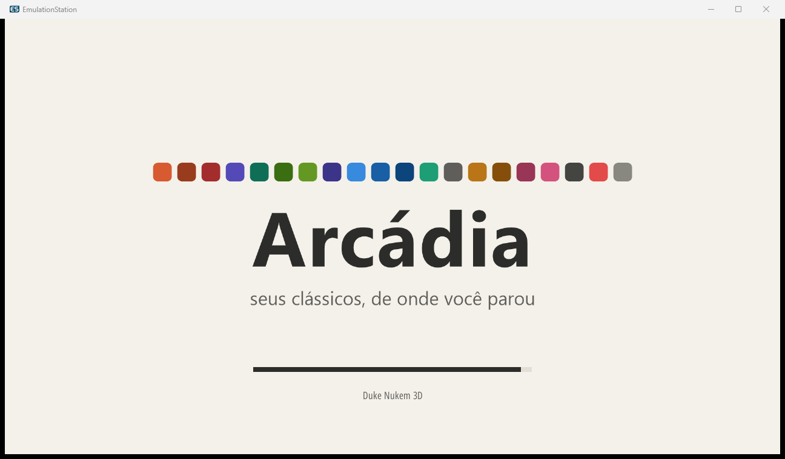
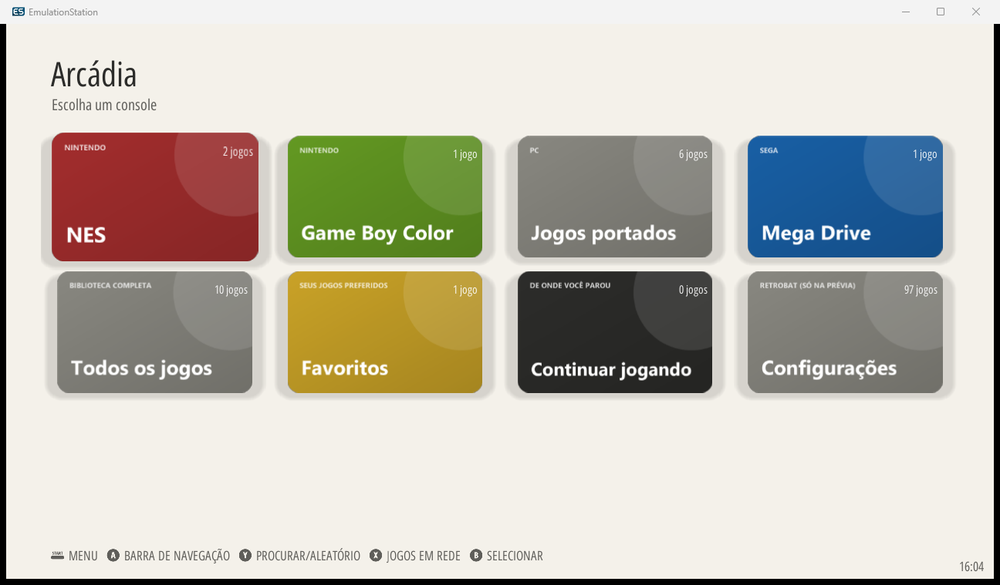
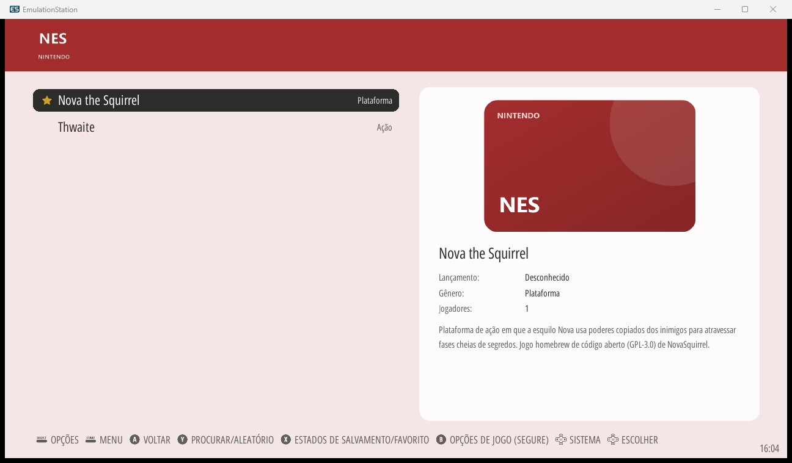
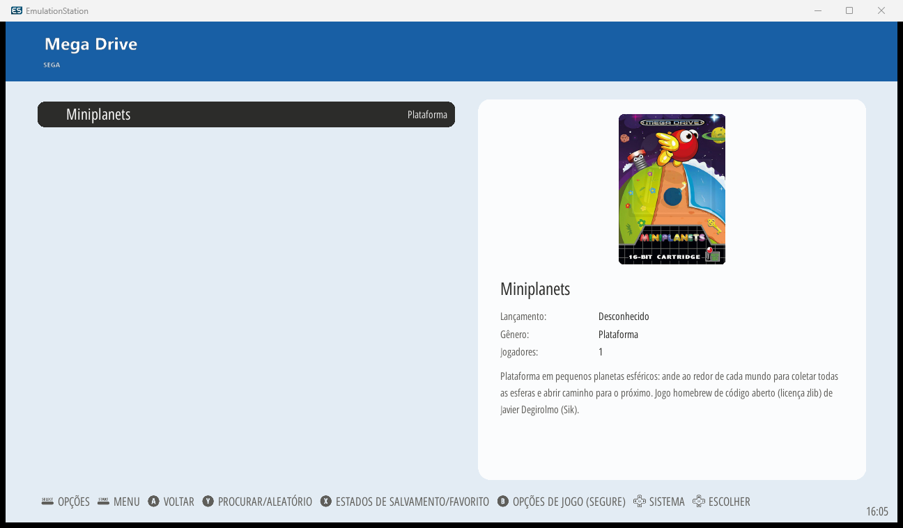
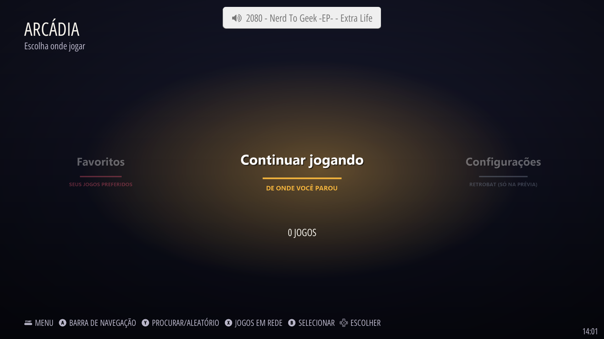
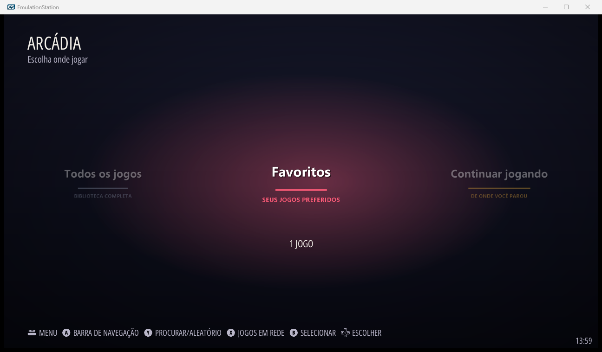
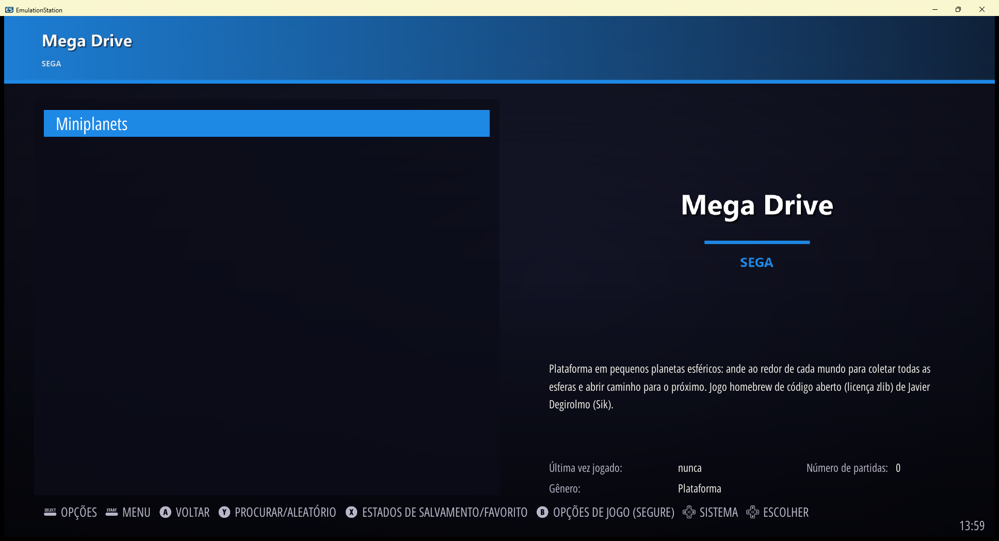

# Prévia do Arcádia no Windows (RetroBat)

Montada em 14/11/2026 (horário de Brasília). Objetivo: ver e testar o visual do Arcádia no computador antes de o aparelho chegar, usando o [RetroBat](https://www.retrobat.org) — frontend gratuito para Windows baseado no EmulationStation da linha Batocera, a mesma base do EmulationStation do EmuELEC.

> **Tema v0.2 (14/11/2026, 16:05):** estilo "colorido por console" do [DESIGN.md](DESIGN.md). Capturas abaixo; as da v0.1 (tema escuro) ficam no fim deste documento.

| Abertura | Início (consoles) |
|---|---|
|  |  |
| **Lista do NES** | **Lista do Mega Drive** |
|  |  |

Tela de abertura do EmuELEC (antes do EmulationStation, só no aparelho): [v02-5-splash-emuelec-1080.png](imagens/previa/v02-5-splash-emuelec-1080.png).

## Como abrir

1. Dê dois cliques no atalho **"Arcádia (prévia)"** na Área de Trabalho (abre `D:\Adube Sistemas\Console de Jogo\arcadia-preview\RetroBat.exe`).
2. Abre em tela cheia, sem vídeo e **sem música**, mostra a abertura do Arcádia e vai **direto para os consoles** (grade de cards).
3. Para sair: botão **Start → Sair** (ou **Alt+F4**).

## Botões

O EmulationStation mostra no rodapé o que cada botão faz em cada tela. Resumo:

| Ação | Controle (posição do botão) | Teclado |
|---|---|---|
| Andar pelos consoles e jogos | direcional / analógico | setas |
| Entrar / jogar | botão de **baixo** (A no controle de Xbox) — aparece como "B" no rodapé | **Z** |
| Voltar | botão da **direita** (B no Xbox) — aparece como "A" no rodapé | **X** |
| Favorito / estados salvos do jogo | botão de **cima** (Y no Xbox) — aparece como "X" | **Q** |
| Procurar / jogo aleatório | botão da **esquerda** (X no Xbox) — aparece como "Y" | **S** |
| Menu principal | **Start** | **Enter** |
| Opções da lista | **Select / Back** | **Backspace** |
| Sair do jogo (salva automaticamente) | **Select + Start** (atalho do RetroArch) | **Esc** (pode pedir para apertar duas vezes) |

Os rótulos do rodapé seguem o padrão Nintendo (A à direita, B embaixo), por isso ficam trocados em relação a um controle de Xbox.

## Como testar o "continuar de onde parei"

1. Entre em um console (ex.: Game Boy Color → µCity) e jogue um pouco.
2. Saia do jogo (Select + Start, ou Esc). O RetroArch grava um save state automático.
3. O jogo aparece em **"Continuar jogando"** na tela inicial.
4. Ao abrir de novo, aparece a janela de **saves** (`ShowSaveStates` ligado): escolha o save automático (com miniatura e data) para continuar de onde parou, ou o item de começar do início.

Favoritos: na lista de jogos, use o botão de cima (Q no teclado) para marcar ou desmarcar. "Nova the Squirrel" já vem marcado (★ dourada na lista), para a coleção "Favoritos" aparecer desde o início.

Favoritar **consoles** (botão Y na tela inicial) é função do `arcadia-emulationstation` e só existe na imagem do aparelho — no RetroBat o Y continua sendo "procurar".

## O que foi instalado

| Item | Origem | Detalhe |
|---|---|---|
| RetroBat v8.3.1.1 estável (64 bits) | instalador oficial `RetroBat-v8.3.1.1-stable-win64-setup.exe` (retrobat.org, publicado em 17/10/2026, 2.012.257.306 bytes, SHA-256 `F8112F12…C721D55`; o arquivo não tem assinatura digital) | `arcadia-preview\` — 33.561 arquivos, 3,76 GB |
| Nova the Squirrel (NES) — GPL-3.0 | [NovaSquirrel/NovaTheSquirrel v1.0.6a](https://github.com/NovaSquirrel/NovaTheSquirrel/releases/tag/v1.0.6a) | `roms\nes` |
| Thwaite (NES) — GPL-3.0 | [pinobatch/thwaite-nes v0.04](https://github.com/pinobatch/thwaite-nes/releases/tag/v0.04) | `roms\nes` |
| Miniplanets (Mega Drive) — zlib | [sikthehedgehog/miniplanets](https://github.com/sikthehedgehog/miniplanets) | `roms\megadrive` |
| µCity (Game Boy Color) — GPL-3.0 | [AntonioND/ucity v1.3](https://github.com/AntonioND/ucity/releases/tag/v1.3) | `roms\gbc` |

Cópias originais do instalador e dos jogos: `arcadia-preview\_instalador\` e `arcadia-preview\_jogos-teste\`.

### ⚠️ Ocorrências na instalação

1. **O instalador ignorou a pasta escolhida.** Mesmo com `/DIR=...arcadia-preview`, ele instalou em `C:\RetroBat`. A instalação foi **movida** para `arcadia-preview` (conferidos 33.561 arquivos e 4.038.135.310 bytes; `C:\RetroBat` deixou de existir). O RetroBat é portátil e funciona normalmente no novo local.
2. **O instalador também instalou componentes de sistema**, apesar de ter sido pedido só o componente principal (`/COMPONENTS="main"`). Isso exigiu permissão de administrador (janelas do Controle de Conta de Usuário):
   - Microsoft Visual C++ 2005, 2008 e 2010 (x86 e x64) e DirectX 9 (bibliotecas antigas usadas por emuladores);
   - **Dokan Library 2.3.1** e **WinFsp 2025** (drivers que o RetroBat usa para abrir jogos compactados/ISO como se fossem pastas).
   **Decisão do usuário (14/11/2026):** manter os Visual C++ e o DirectX e **remover Dokan e WinFsp**. Removidos às 14:11 (Dokan Library 2.3.1.1000 Bundle + MSI x64, WinFsp 2025 e o serviço `WinFsp.Launcher`), conferido que não sobraram programas, serviços, drivers nem pastas. O Windows pede um reinício para concluir a remoção do driver.
   Efeito na prévia: o RetroBat usava o Dokan só para "montar" jogos compactados (.zip/.7z) como unidade; sem ele, descompacta para `roms\.uncompressed` antes de abrir. Os jogos de teste não são compactados, então nada muda.

## Configuração aplicada

Script: [ferramentas/previa/instalar-previa.ps1](../ferramentas/previa/instalar-previa.ps1) (pode ser rodado de novo para atualizar o tema na prévia — feche o RetroBat antes).

| O quê | Onde | Valor |
|---|---|---|
| Tema ativo | `emulationstation\.emulationstation\es_settings.cfg` | `ThemeSet=arcadia` |
| Idioma | `es_settings.cfg` | `Language=pt_BR` (o RetroArch também recebe português do Brasil: `user_language = "7"`) |
| Salvamento/carregamento automático | `es_settings.cfg` | `global.autosave=1` → ao abrir um jogo, o RetroBat grava `savestate_auto_save = "true"` e `savestate_auto_load = "true"` no `emulators\retroarch\retroarch.cfg` (**conferido** abrindo o µCity) |
| Coleções | `es_settings.cfg` | `CollectionSystemsAuto=recent,favorites,all` (Continuar jogando, Favoritos, Todos os jogos) |
| Tela inicial | `es_settings.cfg` | `StartupSystem=nes` (abre direto nos consoles; no aparelho, a ordem coloca os consoles favoritos primeiro) |
| Música de fundo | `es_settings.cfg` | `audio.bgmusic=false` (desligada na prévia) |
| Escolha de save ao abrir jogo | `es_settings.cfg` | `ShowSaveStates=true` (janela "continuar / começar do início") |
| Tela cheia, sem vídeo de abertura, sem trocar idioma sozinho | `retrobat.ini` | `Fullscreen=1`, `EnableIntro=0`, `LanguageDetection=0` |
| Fichas dos jogos em português | `roms\<console>\gamelist.xml` | modelos em [ferramentas/previa/gamelists](../ferramentas/previa/gamelists) |

Onde ficam os saves na prévia: `arcadia-preview\saves\<console>\` (no aparelho, com EmuELEC, ficam em `/storage/roms/savestates/<console>/` e ao lado das ROMs).

## Compatibilidade do tema com o EmulationStation do RetroBat

O tema [temas/arcadia](../temas/arcadia) funcionou **sem nenhuma alteração de compatibilidade**: tela inicial, carrossel, brilho por console, coleções, listas, faixas coloridas, textos em português e rodapé de ajuda apareceram como planejado.

### Ajuste só para a prévia (o tema original não foi alterado)

| Diferença | Motivo | Arquivos |
|---|---|---|
| Logotipo e cor para o item **`retrobat`** ("Configurações — RetroBat (só na prévia)") | o RetroBat tem um "console" próprio com as configurações dele, que não existe no aparelho | [ferramentas/previa/ajustes-tema](../ferramentas/previa/ajustes-tema) — gerados por `gerar-arte.ps1 -Previa` e copiados por cima do tema só dentro de `arcadia-preview` |

### Diferenças de comportamento (não são do tema)

| Item | RetroBat (prévia) | EmuELEC (aparelho) |
|---|---|---|
| Nome do item para abrir no início | `StartupSystem` usa o nome do sistema/coleção (`nes`, `recent`), não a pasta do tema (`auto-lastplayed`) | mesma regra |
| Ordem da tela inicial | coleções e consoles na ordem do RetroBat (inclui "Jogos portados" e "Configurações", que só existem nele) | consoles favoritos → Continuar jogando / Favoritos → demais consoles (`arcadia-emulationstation`) |
| Botão Y na tela inicial | procurar / aleatório | marcar/desmarcar console favorito (`arcadia-emulationstation`) |
| Opção de salvamento automático | `global.autosave` dentro do `es_settings.cfg` | `global.autosave` no `emuelec.conf` |
| Música de fundo | o RetroBat toca músicas e mostra o nome no topo | depende da configuração do EmuELEC |
| Rótulos dos botões | padrão Nintendo no rodapé | igual (mesma base) |

### Melhorias feitas no tema graças à prévia (valem também para o aparelho)

- Logotipo **branco** na faixa colorida das listas de jogos (`logos/claro/`): antes, a linha do fabricante sumia sobre a faixa da mesma cor.
- Jogo sem capa mostra o **logotipo do console** no lugar da imagem (`<default>` do `md_image`).

### Tema v0.2 — o que a prévia ensinou

- `!=` em `<visible>` derruba o EmulationStation ("arquivo de sistemas inválido"); trocado por `!(a == b)`.
- Somar texto com número não funciona; o contador usa dois textos ("1 jogo" e "N jogos").
- Com modelo por linha na lista, a barra de seleção é desenhada pelo tema (escura, arredondada).
- O contorno do card selecionado (`rectangle`) não apareceu no RetroBat; a seleção é indicada pelo card ampliado.

## Pendências da prévia

- "Continuar jogando" começa vazia: aparece com jogos assim que você jogar e sair de algum.
- Os jogos de teste não têm capas/vídeos (seria preciso usar o "scraper" do RetroBat com conta no ScreenScraper).

## Capturas da v0.1 (tema escuro, substituído)

