# Teste da interface no PC (WSLg)

**Data:** 15/11/2026, das 01:25 às 01:56 (horário de Brasília).

**Objetivo:** provar no PC, antes do aparelho chegar, que a interface do Arcádia funciona como no [DESIGN.md](DESIGN.md), e corrigir o que falhasse.

**Como:** o EmulationStation **do fork** (`arcadia-emulationstation`) foi compilado para x86_64 no Ubuntu do WSL e aberto numa janela do Windows pelo WSLg. Usei a mesma configuração de fábrica que vai na imagem:
- o tema `arcadia`;
- o `emuelec.conf` e o `es_settings.cfg` de fábrica;
- os homebrews da prévia.

Os jogos rodaram no RetroArch do Ubuntu com os núcleos fceumm (NES), genesis_plus_gx (Mega Drive) e gambatte (Game Boy Color).

## Como repetir

Ferramentas em [ferramentas/wslg/](../ferramentas/wslg/):

| Arquivo | Para quê |
|---|---|
| `preparar-teste.sh [--zerar]` | Monta no Ubuntu o mesmo ambiente de fábrica da imagem (`/emuelec/configs`, `/emuelec/themes/arcadia`, `/storage/roms`) e uma "home" do teste em `~/es-arcadia`. Use `--zerar` para começar sem favoritos e sem saves. |
| `es.sh abrir \| fechar \| tecla <tecla> [segundos] \| foto <arq>` | Abre o ES em janela 1280×720, envia teclas só para a janela do ES (`xdotool`) e captura a tela. |
| `lancar-jogo.sh` | Faz o papel do `emuelecRunEmu.sh` / `setsettings.sh` do aparelho: lê `-autosave` / `-state_slot` vindos do ES e abre o RetroArch com as mesmas regras de save da imagem. |
| `es_systems-teste.cfg`, `es_input-teste.cfg` | 4 sistemas (NES, Mega Drive, GBC e um SNES **sem jogos**, para testar o "esconder vazios") e o teclado. |

```bash
# dentro do Ubuntu
cd "/mnt/d/Adube Sistemas/Console de Jogo"
tr -d '\r' < arcadia-emulationstation/ferramentas-arcadia/compilar-teste-wsl.sh > /tmp/c.sh && bash /tmp/c.sh   # compila o fork (x86_64) em ~/arcadia-es-teste
tr -d '\r' < console-retro-os/ferramentas/wslg/preparar-teste.sh > /tmp/p.sh && bash /tmp/p.sh
tr -d '\r' < console-retro-os/ferramentas/wslg/es.sh > ~/arcadia-teste/es.sh && chmod +x ~/arcadia-teste/es.sh
~/arcadia-teste/es.sh abrir
```

**Teclado do teste:**

| Botão | Tecla |
|---|---|
| A | X |
| B | Z |
| X | Q |
| Y | S |
| Start | Enter |
| Select | Backspace |
| Direcional | Setas |

## Resultado

| # | O que foi pedido | Resultado |
|---|---|---|
| 1 | Tela inicial em grade com as cores do DESIGN.md | ✅ |
| 2 | Y curto favorita o console: aviso na tela, ★ no card, console vai para o início | ✅ |
| 3 | Y curto de novo desfavorita | ✅ |
| 4 | Y segurado abre a busca | ✅ |
| 5 | Console favorito continua favorito depois de fechar e abrir o ES | ✅ |
| 6 | Menu Start com 6 itens + Modo avançado | ✅ |
| 7 | Jogar, sair e abrir de novo mostra "ONDE VOCÊ QUER COMEÇAR?" com CONTINUAR DE ONDE PAREI (data/hora e miniatura) e COMEÇAR DO INÍCIO | ✅ depois de 3 correções (abaixo) |
| 8 | Lista de jogos no tom do console, favoritos no topo, painel de detalhes | ✅ |
| 9 | "Lançamento: Desconhecido" some quando não há data | ✅ depois de correção |
| 10 | Consoles e coleções sem jogos escondidos, exceto Continuar jogando e Favoritos | ✅ (já era o padrão do ES) |
| 11 | Jogos rodando nos núcleos pedidos | ✅ fceumm, gambatte, genesis_plus_gx |

### 1. Tela inicial

**Grade de cards na ordem do DESIGN.md:** Continuar jogando → Favoritos → NES → Game Boy Color → Mega Drive → Todos os jogos.
- Cada card tem a cor do console, o fabricante, a contagem ("1 jogo" / "2 jogos") e o fundo creme `#F4F1EA`.
- O **SNES, sem jogos, não aparece**.
- A barra de ajuda está em português: MENU, BARRA DE NAVEGAÇÃO, FAVORITAR CONSOLE, ALEATÓRIO, SELECIONAR.

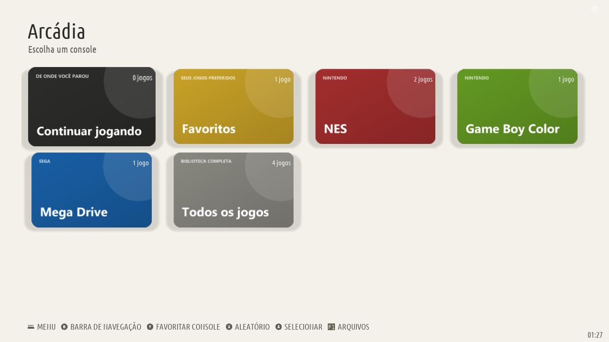

### 2 a 5. Console favorito

**Y curto no NES:**
- aparece o aviso "★ Nintendo Entertainment System ADICIONADO AOS CONSOLES FAVORITOS";
- o NES passa para o primeiro lugar e ganha a ★ no canto do card;
- o `es_settings.cfg` grava `FavoriteSystems="nes"`.

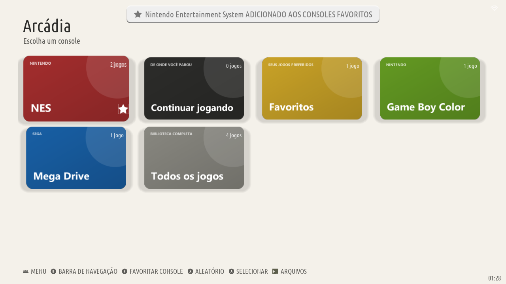

**Fechei e abri o ES:** o NES continuou em primeiro, com a ★.

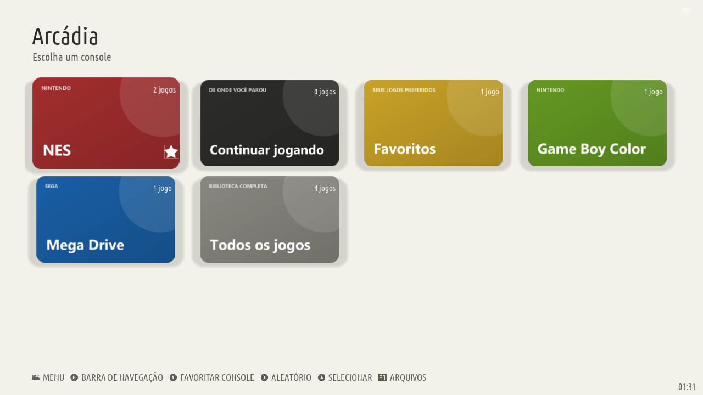

**Y segurado** (1,2 s) abre a **PESQUISA RÁPIDA**.

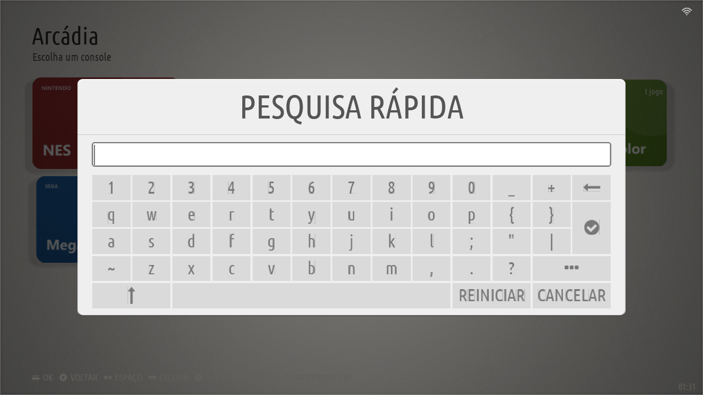

**Y curto de novo:**
- aparece o aviso "REMOVIDO DOS CONSOLES FAVORITOS";
- o NES volta para depois das coleções;
- o `FavoriteSystems` fica vazio.

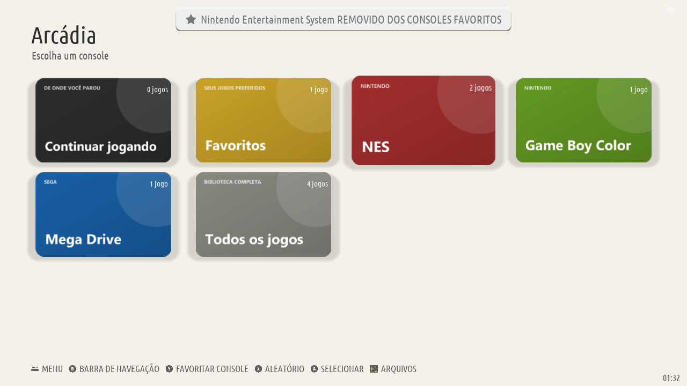

### 6. Menu Start

**MENU PRINCIPAL** com:
1. WI-FI
2. PAREAR CONTROLE BLUETOOTH
3. CONFIGURAR BOTÕES
4. ATUALIZAÇÕES
5. SOM E TELA
6. DESLIGAR COM SEGURANÇA

E **MODO AVANÇADO**, que abre o menu completo do EmuELEC.

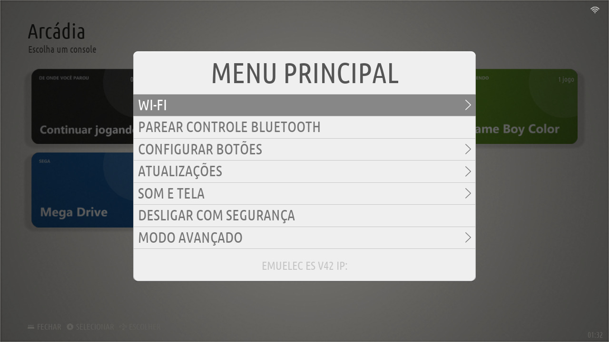 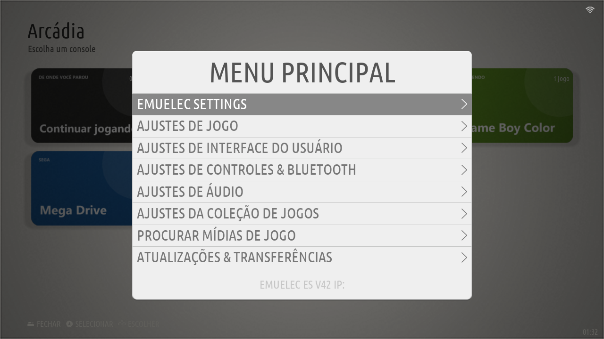

### 7. "ONDE VOCÊ QUER COMEÇAR?"

**Fluxo testado:**
1. Abri o Nova the Squirrel. Era a primeira vez, sem save, então o jogo abre direto. O ES mandou `-autosave 1`.
2. Saí do jogo, e o RetroArch salvou `Nova the Squirrel.state.auto` + miniatura.
3. Abri de novo e apareceu a janela.
4. **CONTINUAR DE ONDE PAREI:** o RetroArch registrou "Auto-loading savestate … succeeded".
5. **COMEÇAR DO INÍCIO:** o ES mandou `-autosave 0`; o jogo abriu do começo e, ao sair, salvou o novo ponto.

Antes e depois da correção do texto cortado:

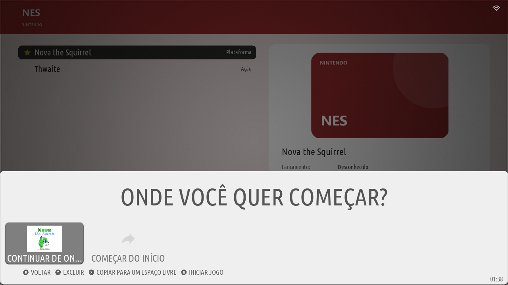
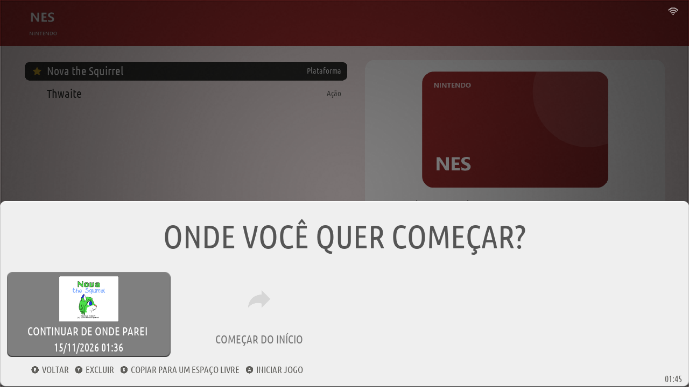

Os jogos rodando (miniaturas que o próprio RetroArch salvou junto com o save):

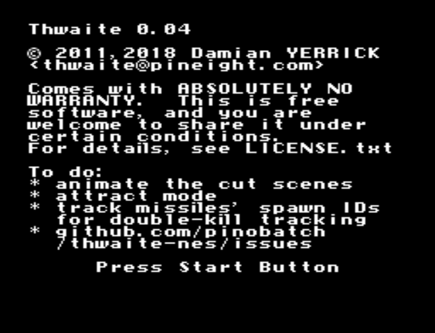

**A coleção "Continuar jogando"** ficou com os jogos jogados, e o card da tela inicial **atualiza a contagem na hora** (correção abaixo).

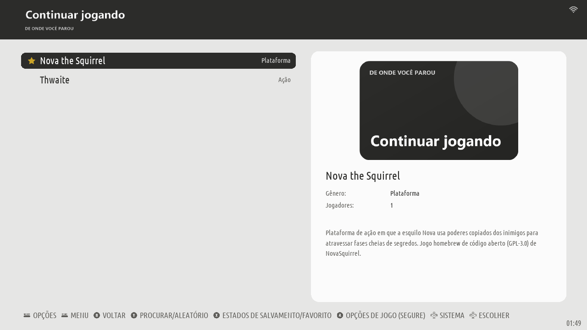
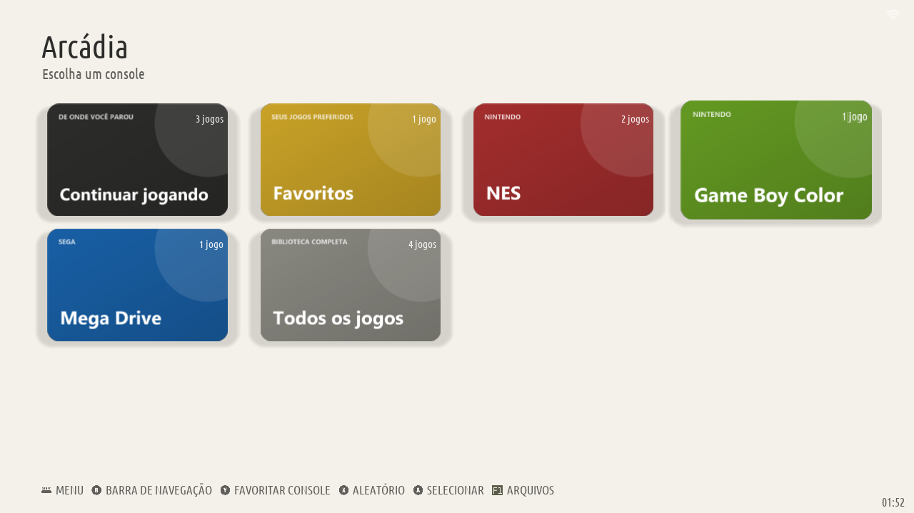

### 8 e 9. Lista de jogos

- Faixa e fundo no tom do console (vermelho do NES).
- Favorito no topo, com ★ dourada.
- Gênero à direita de cada linha.
- Painel com capa (ou o card do console quando não há capa), nome, gênero, jogadores e resumo em português.
- **Lançamento** só aparece quando o jogo tem data.

| Sem data | Com data |
|---|---|
| 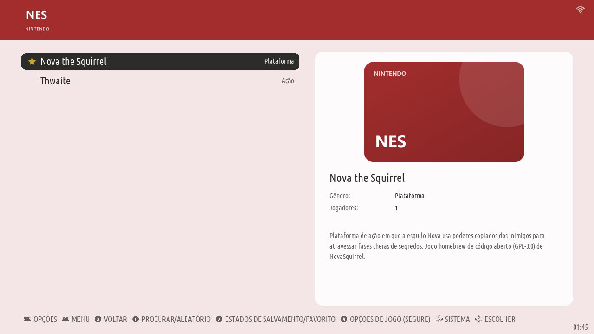 | 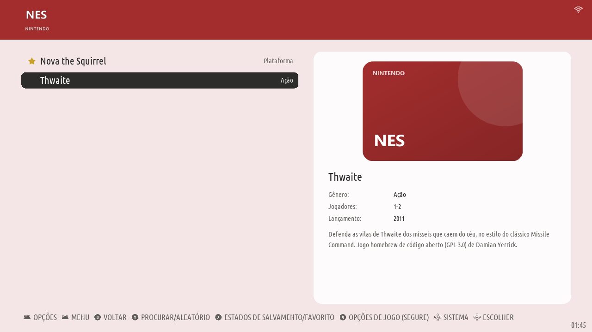 |

## O que estava errado e foi corrigido

| Problema encontrado | Onde | Correção |
|---|---|---|
| A janela "ONDE VOCÊ QUER COMEÇAR?" **nunca apareceria** ao abrir um jogo: a imagem não tinha `global.savestates` no `emuelec.conf` | `packages/sx05re/emuelec/config/emuelec/configs/emuelec.conf` | `global.savestates=2`: mostra a janela só quando o jogo já tem save. A primeira vez abre direto. |
| "COMEÇAR DO INÍCIO" **não salvava ao sair**: o `setsettings.sh` desligava o salvamento automático junto com o carregamento, então "CONTINUAR DE ONDE PAREI" ficava preso no ponto antigo | `packages/sx05re/emuelec/bin/setsettings.sh` | Com `-autosave 0`, só o carregamento é desligado. Salvar ao sair segue o `global.autosave` (ligado de fábrica). **Decisão sua**, ver abaixo. |
| Na janela de saves, o texto aparecia cortado ("CONTINUAR DE ON…") e sem a data/hora | fork, `GuiSaveState.cpp` | 4 cartões por linha (eram 6), janela um pouco mais alta e área de texto com 2 linhas |
| O card "Continuar jogando" mostrava **"0 jogos"** depois de jogar, até reiniciar o ES | fork, `ImageGridComponent.h` + `SystemView.cpp` | Ao voltar para a tela inicial, os cards reaplicam os bindings (`{system:total}`) |
| A ficha do jogo mostrava "Lançamento: Desconhecido" | tema, `theme.xml` | Linha "Lançamento" feita com `{game:releaseyear}` e `<visible>`, colocada por último para não deixar buraco. Os elementos extras do tema precisam de `extra="true"`. |
| `verificar-imagem.sh` acusava falha em "consoles vazios" | `ferramentas/verificar-imagem.sh` | O ES já esconde consoles sem jogos por padrão (`LoadEmptySystems=false`), e o teste comprovou isso. Agora confere esse ajuste e mais 2 itens: `global.savestates=2` e a ficha sem "Desconhecido". |

**Fork:** commit `6ad7cae` na branch `arcadia`, com `PKG_VERSION` atualizado no `package.mk`.

### Decisão sua: "COMEÇAR DO INÍCIO" salva ao sair?

Mudei para **sim**: quem escolhe começar do início e joga um pouco, na próxima vez vê "CONTINUAR DE ONDE PAREI" levando ao ponto mais recente. O efeito colateral é que o ponto antigo é substituído.

Para guardar um ponto importante, use os espaços de save do RetroArch (Hotkey + R1) ou "COPIAR PARA UM ESPAÇO LIVRE" (botão X) na própria janela.

Se preferir o comportamento original do EmuELEC, em que começar do início não salva nada, é só reverter o trecho marcado "Arcádia" no `setsettings.sh`.

## Observações (não são defeitos da imagem)

- **Contagem "duplicada" no card selecionado:** ampliando a captura, é só serrilhado do texto aumentado pelo zoom do card selecionado, com renderização por software (llvmpipe) do WSLg. O mesmo efeito aparece nas letras do teclado da busca. Conferir no aparelho, que tem GPU (Mali-G31).
- **Tela de abertura (splash):** no PC o ES carrega em menos de 1 segundo, e a janela já aparece na tela inicial, então não deu para capturar. O `splash.xml` carregou sem erro no log. **Conferir no aparelho.**
- **Som:** o Ubuntu do WSL não tem placa de som (avisos ALSA no log). Normal no teste.
- **RetroArch pelo Wayland:** no WSLg ele abria pelo Wayland, invisível para o `xdotool`. O `lancar-jogo.sh` força X11 (`unset WAYLAND_DISPLAY`). As fotos do jogo são as miniaturas que o RetroArch grava junto com o save.
- **Textos que continuam do EmuELEC:** dentro do Modo avançado, o título continua "MENU PRINCIPAL" e o primeiro item "EMUELEC SETTINGS" (sem tradução no EmuELEC). No rodapé do menu aparece "EMUELEC ES V42". A Etapa 4 troca isso pela versão do Arcádia.
- **`-state_slot -99` em "COMEÇAR DO INÍCIO":** valor do próprio ES (save "vazio"). No PC o RetroArch aceitou sem problema. Conferir no aparelho que o save manual (Hotkey + R1) continua indo para um espaço válido.

## Só dá para testar no aparelho

- Desempenho real e GPU Mali (serrilhado no zoom, animações).
- Tela de abertura (splash) e o tempo de carga.
- Controle de verdade: Y curto/segurado no tempo do controle, Hotkey para sair do jogo (o save ao sair depende do RetroArch fechar normalmente, como no teste).
- Wi-Fi, Bluetooth, som e saída de vídeo (itens do menu Start que chamam scripts do aparelho).
